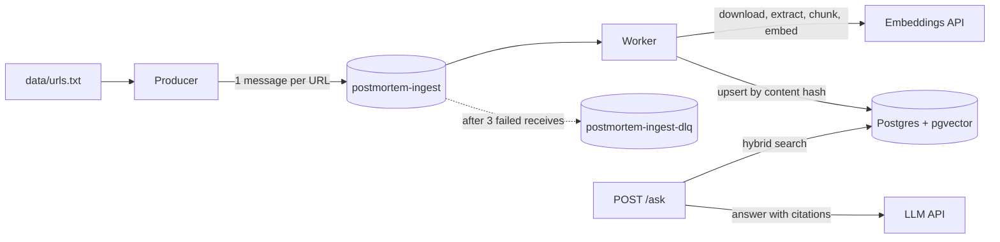

# postmortem-rag

Ask questions about public incident postmortems and get answers grounded in cited sources. Documents flow through a queue-based ingestion pipeline with idempotent workers, and retrieval and answer quality are measured by an automated evaluation.

> **Status: work in progress.** The local stack (Postgres + pgvector, SQS-compatible queue with a dead-letter queue), configuration, queue client, and their tests are in place. The producer, worker, retrieval, API, and evaluation are not built yet. See the [roadmap](#roadmap).

## Why

Postmortems are some of the best material for learning how real systems fail, but they are long and scattered. This project answers questions like these with short answers that cite the report and the passage each claim comes from, and says "I don't know" when the corpus does not cover the question:

- _Which outages were caused by a configuration change pushed globally?_
- _What caused the 18 November 2025 outage and how was it mitigated?_
- _What role did BGP play in past incidents?_

Version 1 uses a single source: the English postmortems on the [Cloudflare blog](https://blog.cloudflare.com/tag/post-mortem/).

## Architecture



**Ingestion**

1. The **producer** reads `data/urls.txt` and sends one message per postmortem URL to `postmortem-ingest`. It never downloads anything.
2. The **worker** receives a message, downloads the page, extracts the title, date, sections, and text, splits it into chunks, creates embeddings, and upserts the chunks into Postgres. It deletes the message only after everything succeeds.
3. If processing throws, the message is not deleted. It becomes visible again after the visibility timeout and is retried. After 3 receives it moves to `postmortem-ingest-dlq`, so permanent failures don't block the queue.

**Querying** (planned)

- **Hybrid search:** vector similarity (pgvector) and Postgres full-text search, combined with reciprocal rank fusion (RRF). Postmortems are full of exact terms (BGP, 1.1.1.1, service names) that vector search alone tends to miss.
- **Answering:** `POST /ask` retrieves the top 5 chunks and asks the LLM to answer only from them, citing each claim as `[n]`. Without support in the sources, it says it doesn't know.
- **Providers behind an interface:** the LLM and embeddings providers can be swapped, including for a local model, without touching the rest of the code.

## Design decisions

| Decision                               | Reason                                                                                                                                                         |
| -------------------------------------- | -------------------------------------------------------------------------------------------------------------------------------------------------------------- |
| Standard queue, at-least-once delivery | A message can arrive more than once, so the worker must be **idempotent**: processing the same message twice must not duplicate data.                          |
| Upsert keyed by content hash           | Reprocessing a postmortem that hasn't changed is a no-op; a changed page replaces its old chunks.                                                              |
| Visibility timeout 60 s                | Worst case per message is about 40 s, given the timeouts on external calls (page download 10 s, embeddings API 30 s). To be revisited with measured durations. |
| `maxReceiveCount` 3                    | Two retries for transient failures; permanent failures go to the DLQ.                                                                                          |
| Long polling (20 s)                    | Avoids empty receives and busy loops.                                                                                                                          |
| SQS API locally via ElasticMQ          | Same API as Amazon SQS with no account or token. Moving to real SQS only changes `SQS_ENDPOINT` and `SQS_QUEUE_URL`.                                           |
| Postgres + pgvector                    | Vectors, full-text search, and metadata in one database, queried with SQL.                                                                                     |

## Tech stack

Node.js 26 and TypeScript (strict, ESM) · Amazon SQS API (AWS SDK v3) with [ElasticMQ](https://github.com/softwaremill/elasticmq) locally · PostgreSQL 18 with [pgvector](https://github.com/pgvector/pgvector) · Zod for configuration · Docker Compose · `node:test`.

## Getting started

Requirements: Node.js 26 (see `.nvmrc`) and Docker.

```bash
npm install
cp .env.example .env
npm run infra:up        # Postgres + pgvector on 5432, ElasticMQ (SQS API) on 9324
npm run smoke           # checks pgvector and sends/receives one message
npm run queue:stats     # message counts per queue, including the DLQ
```

Once the producer and worker exist:

```bash
npm run producer        # enqueue one message per URL in data/urls.txt
npm run worker          # consume and ingest
```

`npm run infra:down` stops the stack. `docker/postgres/init.sql` runs only when the database volume is created, so after changing it, recreate the volume with `docker compose down -v`.

## Configuration

All configuration comes from environment variables, validated at startup by `src/config/env.ts`.

| Variable                                     | Description                                                               |
| -------------------------------------------- | ------------------------------------------------------------------------- |
| `DATABASE_URL`                               | Postgres connection string.                                               |
| `AWS_REGION`                                 | AWS region. Defaults to `us-east-1`.                                      |
| `SQS_QUEUE_URL`                              | URL of the ingest queue.                                                  |
| `SQS_ENDPOINT`                               | ElasticMQ endpoint locally. Leave empty to use the real AWS SQS endpoint. |
| `AWS_ACCESS_KEY_ID`, `AWS_SECRET_ACCESS_KEY` | Any value works with ElasticMQ. In AWS, use an IAM role instead.          |

## Tests

```bash
npm run test:unit         # no Docker needed
npm run test:integration  # needs `npm run infra:up`
npm test                  # both
npm run typecheck
```

The integration tests check, against ElasticMQ, that an unacknowledged message comes back after the visibility timeout and that a message moves to the DLQ after `maxReceiveCount` receives.

## Project layout

```
docker/
  elasticmq/elasticmq.conf   ingest queue and DLQ (redrive policy)
  postgres/init.sql          enables the vector extension
data/urls.txt                postmortem URLs, one per line (texts are not committed)
src/
  config/env.ts              environment validation (Zod)
  queue/sqs-client.ts        SQS client: custom endpoint locally, AWS in production
  queue/sqs-queue.ts         typed send / receive / ack / parse
  db/pool.ts                 pg pool with pgvector types registered
  producer.ts                (to do)
  worker.ts                  (to do)
scripts/                     smoke test and queue stats
test/unit, test/integration
```

## Evaluation (planned)

The goal is to measure the system, not just demo it.

- **Golden set:** 30 hand-written questions, each labeled with the correct postmortem and section. Five have no answer in the corpus, to check that the system admits it doesn't know.
- **Retrieval metrics:** hit rate@5 and MRR.
- **Answer metrics:** valid citations (every `[n]` points to a retrieved chunk) and correct refusals on the unanswerable questions. LLM-as-judge faithfulness comes in the full version, checked by hand on a sample.
- **Output:** a table in the terminal and a versioned results file. The README will compare vector-only and hybrid search.

`npm run eval` will run it. No results yet.

## Roadmap

**Version 1**

- [x] Local stack: Postgres + pgvector, ElasticMQ with DLQ
- [x] Configuration, SQS client and queue wrapper, unit and integration tests
- [ ] `data/urls.txt` with the Cloudflare postmortems
- [ ] Producer
- [ ] Worker: receive, download, extract, delete; failures reach the DLQ
- [ ] Structured logs with a trace ID from producer to worker (Pino)
- [ ] Chunking (by section, ~500 tokens with overlap), with tests
- [ ] Embeddings and idempotent upsert by content hash
- [ ] Hybrid search with RRF
- [ ] `POST /ask` with citations
- [ ] Golden set and `npm run eval`
- [ ] Results and limitations in this README

**Full version**

- [ ] Deploy on AWS with real SQS
- [ ] OpenTelemetry tracing from the API to the worker
- [ ] LLM-as-judge faithfulness
- [ ] CI on GitHub Actions running tests and evaluation
- [ ] A second postmortem source ([danluu/post-mortems](https://github.com/danluu/post-mortems))

**Out of scope:** frontend, authentication, streaming, reranking, agents, fine-tuning.

## Data and rights

The repository stores only the list of URLs and the ingestion code. Postmortem texts are downloaded on the machine that runs the pipeline and are never committed. Answers quote short excerpts and link to the original post.
